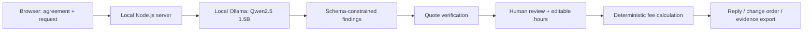

# ScopeShield ↗

**“Just a quick change” shouldn't mean working for free.**

A private scope-creep assistant for freelancers and independent studios. Compare the original agreement with a client's new request, review evidence-linked findings, and turn approved extras into a clear change order.

Built for the **Side Hustle / open-source AI** brief. This is a functional local prototype, with an intentionally narrow workflow and no paid AI APIs.

## Run it

Requirements: Node.js 22+, [Ollama](https://ollama.com/download), and one downloaded text model. No npm installation is needed.

Clone the repository and run it from its root folder:

```sh
git clone https://github.com/swapnil-coder5/SideHustle.git
cd SideHustle
ollama pull qwen2.5:1.5b
npm start
```

Open **http://127.0.0.1:3210**. Keep Ollama running. On a new installation, run `ollama serve` if the desktop app hasn't started the service. Initial runtime/model downloads require internet. With those installed, the app and inference use only loopback connections and can work offline.

On this development machine, Ollama and `qwen2.5:1.5b` were already available. The app defaults to this Apache 2.0 model. Installed models appear in **Local AI settings**. Do not assume that every model in a family has the same license: Qwen2.5 3B uses a different license, so it is not our default.

Optional configuration:

```powershell
$env:PORT = '3210'
$env:OLLAMA_MODEL = 'qwen2.5:1.5b'
npm start
```

The Ollama host is deliberately fixed at `http://127.0.0.1:11434`. Model swapping is local; there is no cloud fallback.

GitHub hosts the source code. Run this app locally; GitHub Pages cannot run its Node.js server or connect to the developer's Ollama instance.

## Try the demo

1. Choose **The “tiny” website update** and click **Load example**.
2. Click **Find the scope creep** for a fresh local AI analysis. CPU inference can take several minutes.
3. Review source quotes and classifications. The model's interpretation can be wrong even when its quotes match.
4. Review or correct each classification, then set your own hour estimates. Live reports start at zero hours; copying or exporting the proposal is disabled until every selected addition has a positive valid estimate. Deselect extras you do not want to propose.
5. Choose Warm, Direct, or Firm; edit the reply before copying it.
6. Download a Markdown change order or JSON evidence report. Use Print / PDF for the displayed report.

**See sample report** loads a clearly labeled, prewritten walkthrough. It does not pretend to be model inference, and uses fixed illustrative hours. It replaces the inputs with the selected example. Live findings may differ and never invent your labor estimate.

Other examples cover a logo project that expands into packaging and a launch film that expands into localization.

## What makes this more than a chat wrapper

- **Source verification:** each request passage is kept verbatim. The model selects agreement evidence from a schema-constrained list of real passages, narrowed by keyword overlap when possible. The server checks the returned text again, ignoring case and whitespace. A failed check downgrades the finding to “needs review” and excludes it from proposed charges.
- **Three-way classification:** included work, out-of-scope work, and ambiguity are distinct. Ambiguity is not silently treated as billable.
- **Deterministic money:** the app calculates fees from selected items, editable hours, and the freelancer's rate. The model cannot invent the final total.
- **Human approval:** nothing sends, invoices, or charges a client. A downloaded change order is a draft.
- **Explicit revision checks:** narrow deterministic checks handle statements that all included revision rounds are completed or that a revision round has not been used. The evidence export preserves the original model classification when these checks correct it. Ambiguous revision history still needs a person.
- **No automatic storage:** documents and reports remain in process/browser memory until export. Refreshing loses the workspace. No database, analytics, remote fonts, or third-party scripts.
- **Local service boundaries:** the web server binds only to loopback, rejects unexpected Host headers and cross-origin API requests, and serves only explicitly allowed assets. This is a single-user local app, not a multi-user hosted service.

The AI is essential: it compares the semantic meaning of arbitrary agreements and messages. It analyzes each candidate request passage separately, which worked better with the small installed model than asking it to generate one large report. Request passages are selected by simple action-word heuristics; write one request per sentence or line for best results. Multiple deliverables in one sentence may be grouped together. The sample walkthrough is the only prewritten analysis. Reply phrasing is deterministic, with a human-editable tone; it does not require another model call.

## Architecture



The Node server uses only built-in modules. The browser uses native ES modules and local CSS. Ollama runs the open-weight model. You can inspect or change the prompt and response schema in `lib/analyze.mjs` without changing a proprietary service.

## Who would pay?

Initial customer: a freelance web designer whose fixed-fee projects expand through informal client messages. The product helps them identify and explain changes before doing unpaid work.

**Pricing hypothesis, not validated revenue:** $29 for a packaged desktop edition, with a proposed $79 studio edition for reusable templates and project history. Those editions and features are not implemented. Paid value would come from packaging, onboarding, updates, and support. Local inference avoids per-review API billing but still uses the customer's hardware and electricity. No paid customers or measured time savings are claimed.

## Validation

```sh
npm test
npm run test:live
node scripts/live-check.mjs brand
```

The automated tests exercise input validation, fabricated evidence, invalid numeric output, explicit revision status, and HTTP boundaries. The live check calls the actual installed model and saves output to ignored `artifacts/live-analysis.json` and per-example files. It asserts the expected classifications for each example. These are development smoke checks, not an independent accuracy benchmark. Results vary by model. See `VALIDATION.md` for completed checks and limits.

## Limits

This prototype imports plain text and Markdown only. It does not extract PDF, OCR images, connect to inboxes, manage history, send email, or collect payments. Documents are limited to 16,000 characters each and reviews to eight candidate request passages. The default model has a finite context window, so shorter agreements are preferable. Request extraction and lexical evidence retrieval can miss relevant context; a model can select real but irrelevant evidence. Analysis errors and long CPU latency are possible. Your estimates, legal interpretation, third-party costs, rights, taxes, and dates need human confirmation. Source matching prevents fabricated quotations from becoming selected charges; it cannot prove that a conclusion is correct.

An Ollama runtime may manage its own model caches or logs. ScopeShield does not control other software on the device. Do not expose the app or Ollama to the public internet. Model and runtime licenses apply separately; model weights are not bundled.

The application package is marked `UNLICENSED`; no application license is included. The open-weight model and Ollama are separate components with their own licenses.

## Submission kit

- `SUBMISSION.md`: editable article draft, open-innovation explanation, and commercial case.
- `DEMO.md`: 90-second recording script and tonight's handoff tasks.
- `VALIDATION.md`: actual validation and remaining verification limits.

References: [Ollama structured output API](https://docs.ollama.com/api/generate), [Qwen2.5 1.5B model card](https://huggingface.co/Qwen/Qwen2.5-1.5B-Instruct).
