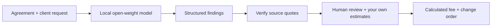

# ScopeShield: The Local AI That Turns “Just One More Thing” Into a Change Order

> Submission draft. Add your actual screenshots before publishing. Verify the deadline, tags, and required fields on the organizer's page. Do not present sample estimates as benchmark results or earned revenue.

## What I built

Every freelancer knows this message:

“Love the site! Could we just add a shop, three more pages, and one more revision before launch?”

The hard part isn't writing an invoice. It's recognizing the extra work, finding the agreement that supports your boundary, and saying it without making the relationship awkward.

**ScopeShield** is a private scope-creep assistant for independent creatives. Paste the original agreement and the new client request. An open-weight model running on your machine separates the requests into included work, potential extras, and items that need clarification.

Each finding comes with the original request passage and a source passage selected from the agreement. Set your own estimated hours, choose which additions to propose, and get a reply and draft change order.

**Source code:** [ScopeShield on GitHub](https://github.com/swapnil-coder5/SideHustle)

**Demo video:** [Watch or download the ScopeShield walkthrough](https://github.com/swapnil-coder5/SideHustle/blob/main/demo/ScopeShield-demo.mp4)

**Run locally:** `npm start`, with Node.js 22+ and Ollama running `qwen2.5:1.5b`. See the repository README for setup. This is deliberately a local application; the core AI does not need a hosted backend.

## The moment to watch

The fictional example starts with a $2,400 five-page website agreement. The new message asks for a shop, extra service pages, another design revision, and a working mobile contact form.

The **illustrative sample walkthrough** marks the first three as extra, keeps the mobile contact-form check included, and proposes 21 editable hours at $85/hour: **$1,785**. These are fictional estimates, not measured revenue recovered. A live report computes fresh findings and starts with zero hours: the freelancer sets the estimates before exporting a proposal.

Uncheck an addition or change its hours and the fee and reply update together. The freelancer remains in control of the proposal.

## Why open innovation matters

The open model is the engine, not decoration. It interprets the relationship between an arbitrary agreement and a new request. Without that semantic comparison, the product would be a blank change-order template.

The default model is **Qwen2.5 1.5B Instruct**, served locally through **Ollama**. Its model card lists Apache 2.0 licensing. The browser and server have no npm dependencies.

This approach gives the product three practical advantages:

1. **Client confidentiality.** Contracts, commercial rates, and client messages can remain on the freelancer's machine. ScopeShield has no cloud inference fallback or analytics. After the runtime and model are downloaded, analysis works without internet.
2. **A different business cost structure.** There is no per-review model API bill. Running a local model still costs compute and electricity, but a one-time product license is easier to explore without carrying recurring inference fees.
3. **Control.** The prompt, JSON schema, quote checks, and fee logic are inspectable. Users can swap an installed local model and change the workflow without relying on one provider's pricing or product decisions. Model licenses still need individual review.

A closed cloud API could do this comparison too. For this product, local control is useful because the inputs are confidential business documents and the intended customer is a solo operator watching recurring costs.

## The engineering detail I'm proud of

I didn't want a polished interface that simply trusted everything a model said.

The model evaluates one request passage at a time and selects agreement evidence from a constrained list of real source passages. Before showing a finding as a selected extra, the server verifies that the quoted text exists in the provided source. Missing or fabricated evidence downgrades a finding to “needs review” and removes it from the proposed charges.

That check does not guarantee correct reasoning. It creates a reviewable path from claim to source and keeps unsupported quotations from silently turning into a fee.

The final amount is calculated in code from selected items, hours, and the user's rate. Included work is assigned zero paid hours. No message or payment is sent automatically.

The small model initially made mistakes counting used revision rounds. Rather than hide that, I added explicit revision-status checks, preserved the original AI decisions in the evidence export, and made every classification editable. The model still performs the semantic comparison; deterministic checks and a person handle what should not be left to model confidence.

## The side hustle

The first customer I'd test this with is a freelance web designer working on fixed-fee websites. They already have the inputs: a proposal and a client message. They need a clear boundary before the extra work starts.

My proposed business model is a **$29 packaged desktop edition**, with setup, updates, and support. A possible **$79 studio edition** could add reusable templates and local project history. These are pricing hypotheses and future features, not existing paid plans. The current working version uses an open-weight model, and customer willingness to pay remains unvalidated.

## What works today, and what comes next

Today: local model integration, plain-text import, evidence checking, three example projects, editable hours, selectable extras, three reply tones, Markdown change orders, JSON evidence exports, and print/PDF styling.

The prototype has meaningful limits: small models can misread agreements; source matching doesn't validate interpretation; CPU inference can be slow; legal and pricing decisions require human review. PDF extraction, project history, and desktop packaging would come after testing this core workflow with real freelancers.

**AI assistance disclosure:** This project and article were developed with substantial AI assistance. The repository includes the prompt and validation checks for inspection.
